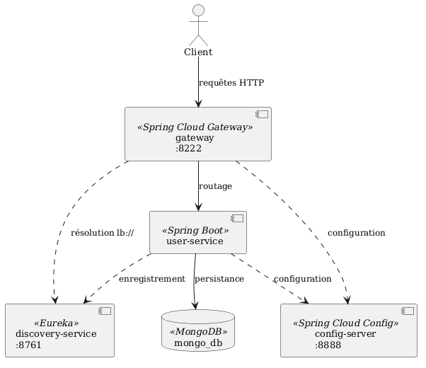
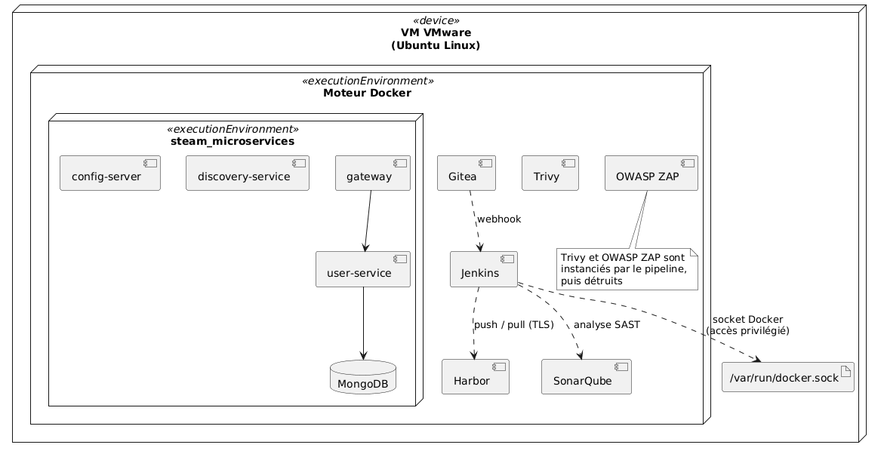
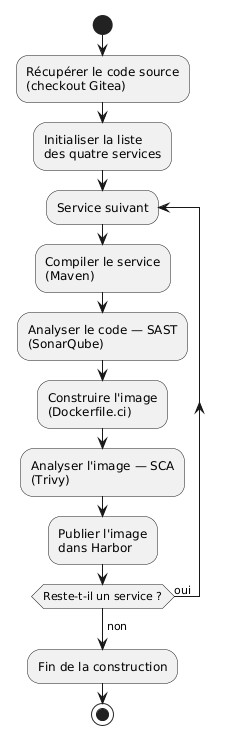
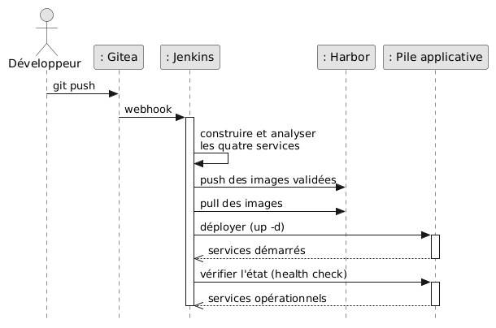
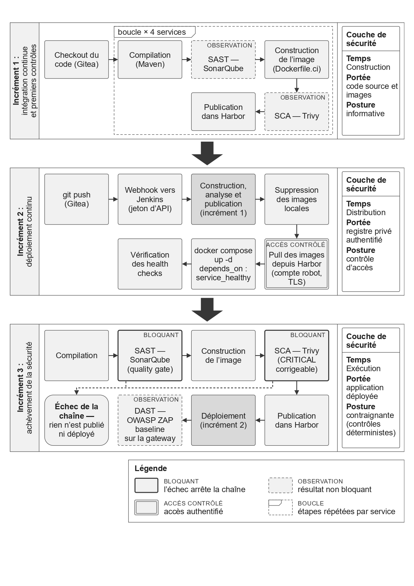

# Chaîne CI/CD DevSecOps — Microservices Spring Boot


Chaîne **CI/CD sécurisée (DevSecOps)** pour une architecture de microservices *Spring Boot*,
réalisée lors d'un stage chez **Proxym Group** (été 2026). D'un *push* au déploiement vérifié,
sans intervention manuelle, avec la sécurité intégrée à chaque étape.

> La sécurité n'est pas ajoutée en fin de parcours, mais **tissée progressivement** :
> d'abord *informative* (observation), puis *contraignante* (barrières bloquantes).

<!--  Démo : ajouter ici le lien ou le GIF de la vidéo -->

---

## Ma contribution

L'application microservices était fournie par l'équipe d'accueil. Ce dépôt contient
**la chaîne de livraison que j'ai conçue et réalisée** :

- le **pipeline Jenkins** (*pipeline as code*) : build, analyses de sécurité, publication, déploiement, DAST ;
- les **Dockerfiles** des 4 services (images JRE Alpine, exécution en utilisateur **non-root**) ;
- le **déploiement Docker Compose** avec ordre de démarrage piloté par les *healthchecks* ;
- l'intégration et le durcissement de la **sécurité** : SAST, SCA et DAST, registre privé authentifié.

## Architecture

**4 services** d'une plateforme *Spring Cloud* et leur base de données :
`config-server` (8888) · `discovery-service` / Eureka (8761) · `gateway` / JWT (8222) ·
`user-service` (8090) + **MongoDB**.

<p align="center">
  
</p>

L'outillage (Gitea, Jenkins, Harbor, SonarQube) et l'application tournent sur une VM unique,
avec un moteur Docker commun :

<p align="center">
  
</p>

## Pipeline

Déclenchement automatique par **webhook Gitea → Jenkins** (authentifié par jeton d'API,
protection CSRF conservée). Pour chaque service :
compilation → SAST → build image → SCA → publication ; puis déploiement, vérification de
santé et analyse dynamique.

<p align="center">
  
  &nbsp;&nbsp;&nbsp;
  
</p>

## Sécurité intégrée

| Étape | Outil | Posture |
|---|---|---|
| SAST — code source | SonarQube | **Bloquante** : échec si le *quality gate* n'est pas franchi |
| SCA — image et dépendances | Trivy | **Bloquante** : échec sur vulnérabilité **CRITICAL corrigeable**, *avant* publication |
| Distribution | Harbor | Registre privé, compte robot à droits minimaux, secrets dans le magasin Jenkins |
| DAST — application déployée | OWASP ZAP (baseline) | Observation : alertes non déterministes sur une application de démonstration |

<p align="center">
  
</p>

## Problèmes résolus

| Symptôme | Cause | Solution |
|---|---|---|
| Webhook Gitea refusé (403 puis 400) | Jeton CSRF absent, puis mauvais point d'entrée | Jeton d'API + `buildWithParameters`, **sans désactiver CSRF** |
| `waitForQualityGate` n'aboutit jamais | Aucun webhook SonarQube → Jenkins | Webhook `http://jenkins:8080/sonarqube-webhook/` sur un réseau Docker partagé |
| Services démarrés mais non fonctionnels | Démarré ≠ opérationnel | `healthcheck` + `depends_on: service_healthy` |

## Limites connues et perspectives

- **Socket Docker partagé avec Jenkins** : accès équivalent root sur l'hôte. Risque identifié
  et documenté ; pistes : agents isolés, moteur *rootless*.
- **DAST non authentifié** : le scan ne couvre que la surface publique de la gateway (JWT).
- **Machine unique** : passage à Kubernetes envisagé pour la résilience et la mise à l'échelle.

## Lancer le pipeline

Pré-requis : une VM Linux avec Docker ; Gitea, Jenkins, Harbor et SonarQube démarrés sur un
réseau Docker commun ; Jenkins configuré (socket Docker, *credentials* `gitea-creds` et
`harbor-robot`, serveur SonarQube `sonar`).

Le pipeline se lance à chaque *push*, ou via *Build with Parameters* :

| Paramètre | Rôle |
|---|---|
| `IMAGE_TAG` | Version des images construites et déployées |
| `RUN_TESTS` | Exécuter les tests unitaires |
| `DEPLOY` | Déployer après le build |

## Structure

```
.
├── Jenkinsfile                  # pipeline as code
├── docker-compose.deploy.yml    # déploiement de la pile applicative
├── dockerfiles/                 # Dockerfile.ci (chaîne) et Dockerfile.optimized (multi-stage) par service
└── docs/                        # diagrammes
```

> Le code source des microservices (fourni par l'équipe d'accueil) n'est pas inclus.

---

**Autrice :** Farah Grissa — ENSI, spécialité IA · Stage d'été chez Proxym Group